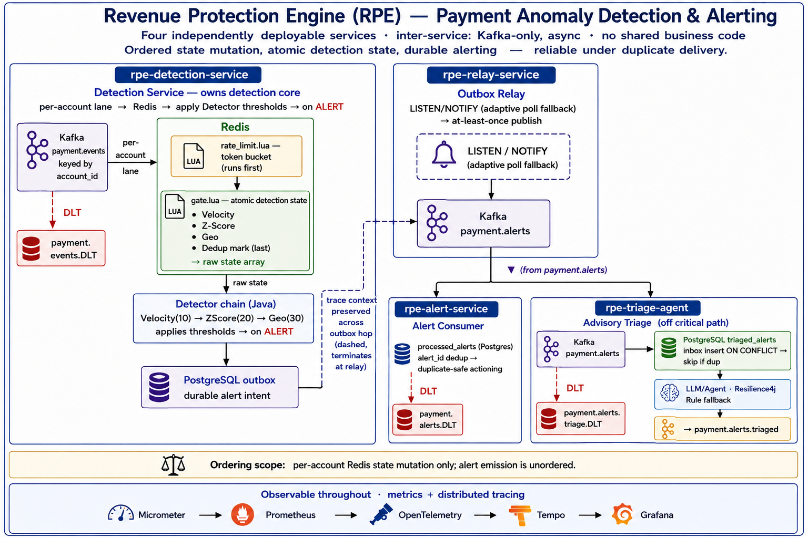
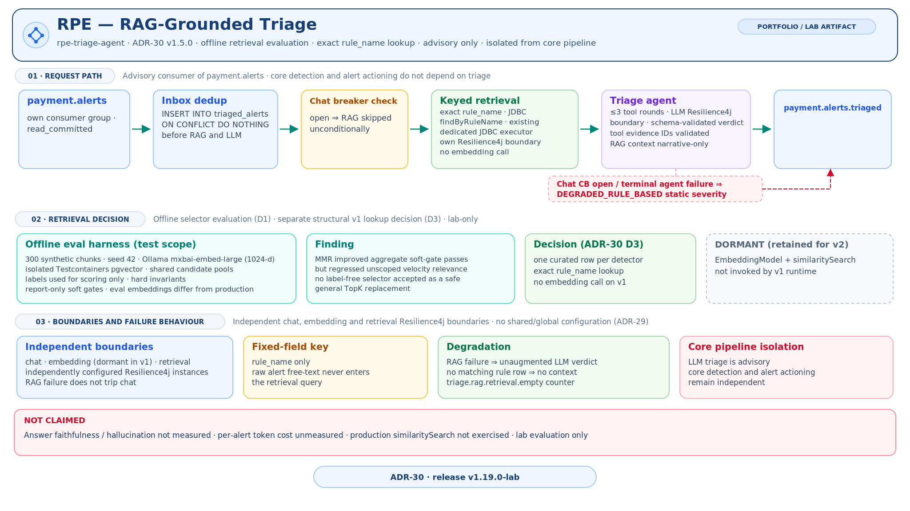
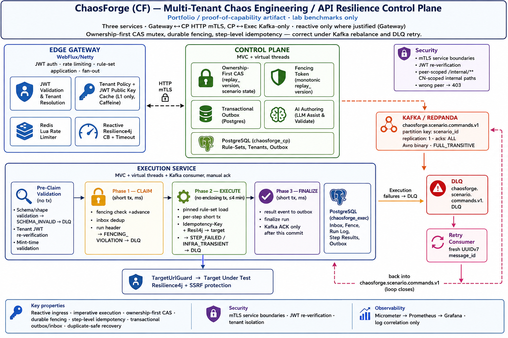
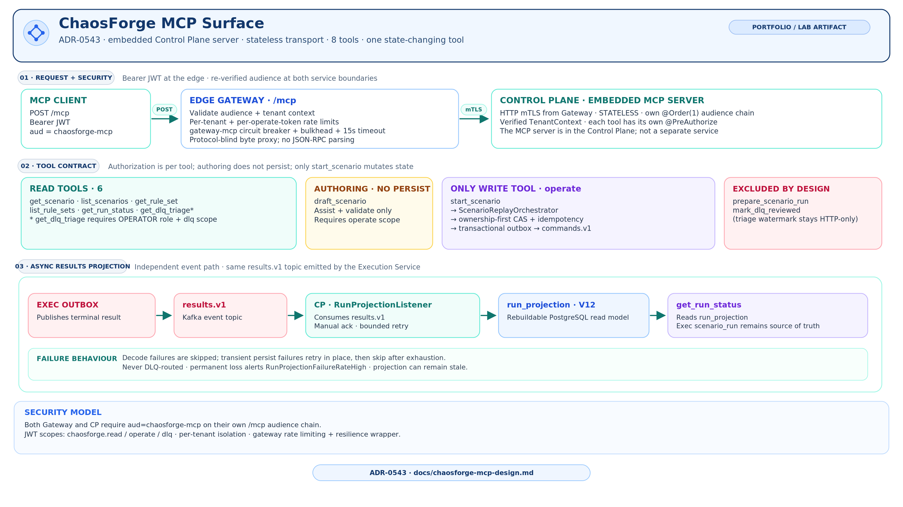
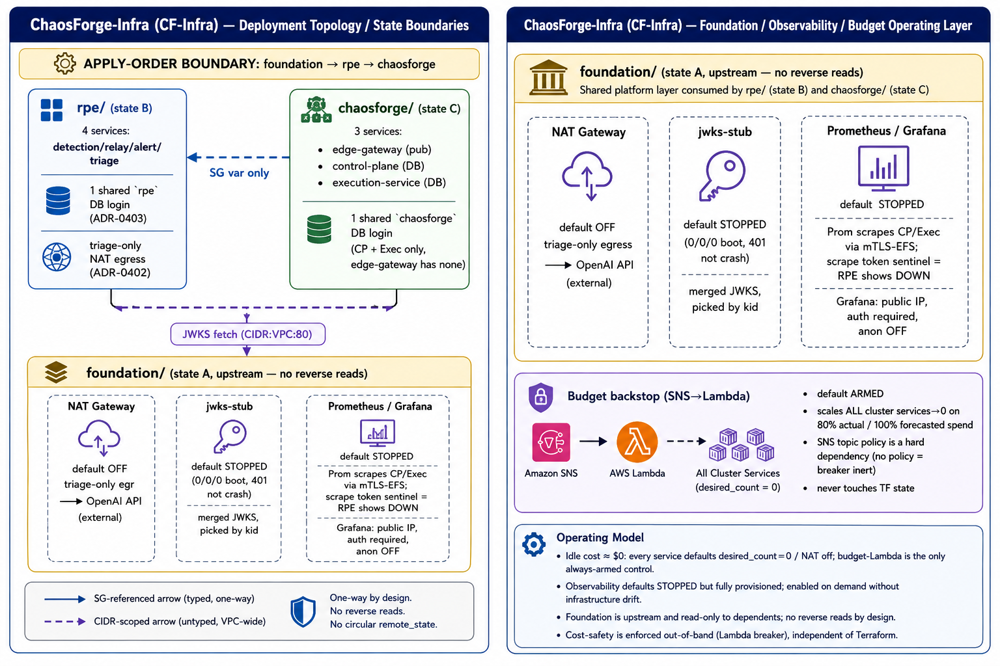

### Amit Vikram Satpathy
Backend & Distributed Systems Engineer | Java, Spring Boot, Kafka, AWS

8+ years across ERP, performance monitoring, enterprise benefits (Netflix OSS architecture), early-stage e-commerce, and a hybrid-cloud payment integration. Since May 2025 I have been building three lab projects to practise distributed-correctness patterns under concurrency: **RPE** (payment anomaly detection), **ChaosForge** (chaos-engineering control plane) and **ChaosForge-Infra** (their AWS deployment layer).

**How I work:** these systems are built with AI-assisted development. I own the architecture, the ADRs and the verification: every non-obvious decision is an ADR, and each release's notes state what is and is not verified. All three are lab / reference systems, not production deployments.

---

**Focus areas**
- **Event-driven architecture** — Kafka transactional outbox/inbox, idempotent consumers, partition-keyed ordering (at-least-once + idempotent consumer, never trusting a transport's exactly-once claim)
- **Distributed correctness** — CAS ownership-fencing (chosen over Redlock: local lock-holding correctness ≠ system-wide safety under clock skew/GC pause)
- **Resilience engineering** — Resilience4j per boundary, fail-closed by default with explicit, deliberate fail-open exceptions
- **Ephemeral IaC** — independent multi-root Terraform state, keyless deployment pipelines, budget-triggered scale-to-zero
- **AI integration** — Spring AI (Ollama/OpenAI) for advisory workflows; LLM calls kept off critical execution/replay paths by design

**Engineering projects** *(reference architectures, lab-only)*

- 🛡️ **RPE** — four independently deployable services: Redis Lua atomic detection gate, transactional outbox, deterministic UUIDv5 replay-safe alert IDs. An advisory Spring AI triage agent, off the critical path, is grounded by an exact `rule_name` lookup (ADR-30) behind its own circuit breaker; an offline evaluation harness bounds any future similarity retrieval.
    
  
    

  **RAG integration & evaluation** — advisory Spring AI triage uses exact `rule_name` lookup on the v1 runtime path; a test-scoped pgvector harness compared TopK, dedup, MMR and relative-floor selectors. Production similarity retrieval remains dormant.
    
  
    
  📄 [RPE ADR Index (30 decisions)](https://github.com/amitvsatpathy90-source/revenue-protection-engine/blob/main/docs/adrs/README.md) · 🏷️ [Release v1.19.0-lab](https://github.com/amitvsatpathy90-source/revenue-protection-engine/releases/tag/v1.19.0-lab)
    

- 🌀 **ChaosForge** — multi-tenant chaos-engineering control plane: CAS fencing tokens, step-level idempotency, two-level cache with disclosed staleness bounds.
    
  
    
  📄 [ChaosForge ADR Index (44 decisions)](https://github.com/amitvsatpathy90-source/chaosforge/blob/main/docs/adrs/README.md) · 🏷️ [Release v1.27.0-lab](https://github.com/amitvsatpathy90-source/chaosforge/releases/tag/v1.27.0-lab)
    

  **MCP integration** — stateless Spring AI MCP server embedded in the Control Plane; eight tools, with `start_scenario` as the sole state-changing tool. Dedicated Gateway audience and per-tool authorization; the write path reuses the existing replay orchestrator.
    
  
    
  📄 [ADR-0543: Embedded MCP Server](https://github.com/amitvsatpathy90-source/chaosforge/blob/main/docs/adrs/ADR-0543.md) · [MCP Server Design](https://github.com/amitvsatpathy90-source/chaosforge/blob/main/docs/chaosforge-mcp-design.md)
    

- ☁️ **ChaosForge-Infra** — 3-root Terraform deployment (foundation → RPE → ChaosForge) on AWS ECS Fargate with IAM OIDC keyless deploy, EFS, Cloud Map and a budget-triggered scale-to-zero breaker. One live apply session is recorded: RPE and foundation services reached steady state, and one Gateway request validated JWT and Gateway→Control Plane mTLS.
    
  
    
  📄 [ChaosForge-Infra ADR Index (4 decisions)](https://github.com/amitvsatpathy90-source/chaosforge-infra/blob/main/docs/adrs/README.md) · 🏷️ [Release v1.1.0-lab](https://github.com/amitvsatpathy90-source/chaosforge-infra/releases/tag/v1.1.0-lab)
    

**Open to:** senior backend / distributed-systems IC roles, full-time or contract. NCR or remote. [LinkedIn](https://www.linkedin.com/in/amit-vikram-satpathy/) · amitv.satpathy90@gmail.com
