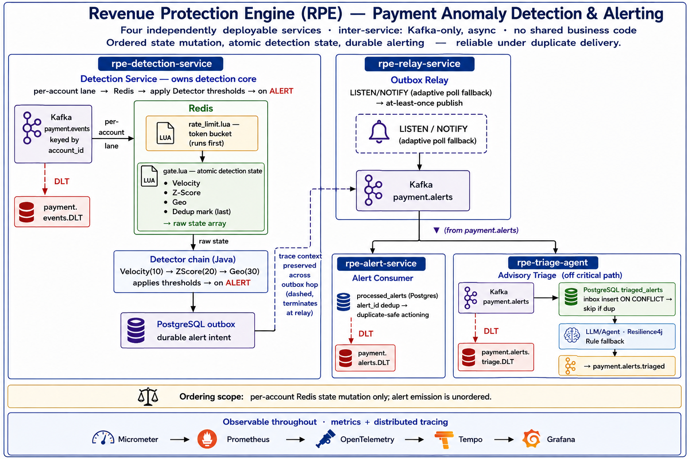
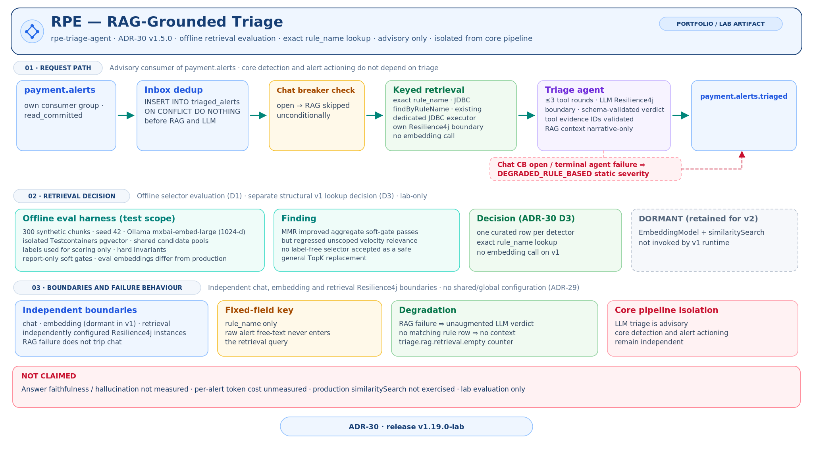
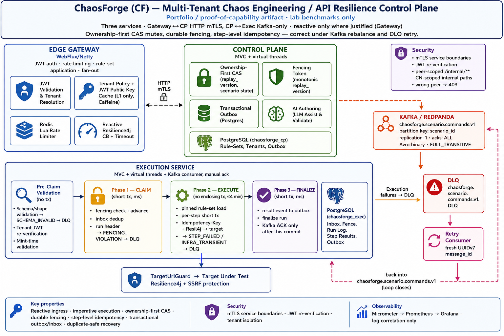
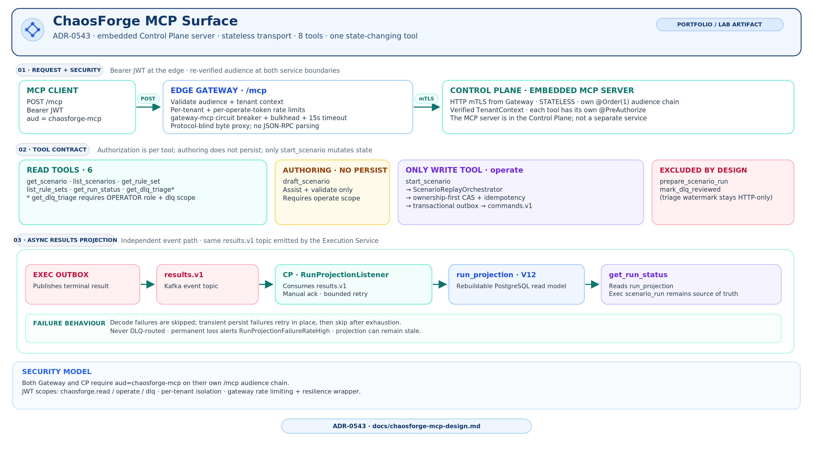
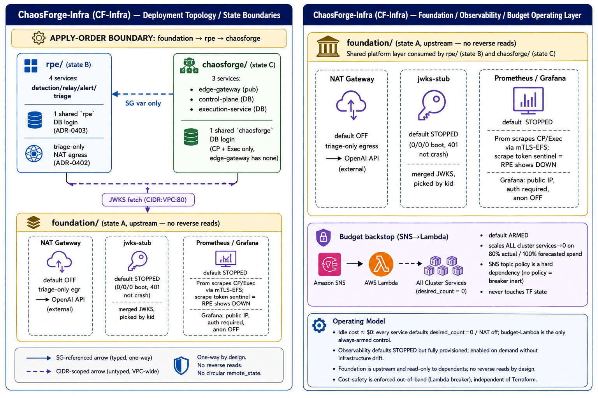

# Amit Vikram Satpathy

**Senior Backend Engineer** · Java · Spring Boot · Microservices · Kafka · Distributed Systems · AWS · Terraform · Spring AI · MCP · RAG

I'm a backend engineer with 8+ years across ERP, performance monitoring, enterprise benefits (Netflix OSS architecture), and early-stage e-commerce, plus a hybrid-cloud payment-integration engagement. My engineering focus is distributed systems and correctness under concurrency: ordering, idempotency, ownership fencing, and failure handling.

**Open to:** Senior Backend Engineering, Distributed Systems and Platform Engineering roles [LinkedIn](https://www.linkedin.com/in/amit-vikram-satpathy/) · amitv.satpathy90@gmail.com

Since May 2025, I've been building three lab/reference systems to explore distributed correctness under concurrency. These are not production deployments.

## Engineering projects

- 🛡️ **RPE** — Payment anomaly detection: Redis Lua atomic detection gate, transactional outbox, replay-safe alert IDs, and advisory Spring AI triage.
- 🌀 **ChaosForge** — Multi-tenant chaos-engineering control plane: CAS ownership fencing, step-level idempotency, bounded-staleness caching, and embedded Spring AI MCP integration.
- ☁️ **ChaosForge-Infra** — Three-root Terraform deployment on AWS ECS Fargate, with IAM OIDC keyless deployment and a budget-triggered scale-to-zero mechanism.

**How I work:** I define the scenarios and make the design decisions. AI assists with ADR drafts and implementation scaffolding; I review and correct the output and own verification. Release notes state what is and isn't verified.

---

## Project details

### 🛡️ RPE — Revenue Protection Engine

Four independently deployable services with a Redis Lua atomic detection gate, transactional outbox, and deterministic UUIDv5 alert IDs for replay-safe identity.

An advisory Spring AI triage agent stays off the critical path. It uses exact `rule_name` lookup (ADR-30), protected by its own circuit breaker.

**RAG evaluation**

The v1 triage runtime uses exact `rule_name` lookup. A test-scoped pgvector harness compared TopK, deduplication, MMR, and relative-floor selectors; query-time embeddings and cosine-similarity retrieval are not enabled in the runtime.

📄 [RPE ADR Index](https://github.com/amitvsatpathy90-source/revenue-protection-engine/blob/main/docs/adrs/README.md) · 🏷️ [Release v1.19.0-lab](https://github.com/amitvsatpathy90-source/revenue-protection-engine/releases/tag/v1.19.0-lab)

### 🌀 ChaosForge — Chaos Engineering Control Plane

A multi-tenant chaos-engineering control plane built around CAS ownership-fencing tokens, step-level idempotency, and a two-level cache with explicit staleness bounds.

**MCP integration**

The Control Plane embeds a stateless Spring AI MCP server. Its eight tools allow AI clients to inspect scenarios and rules, get guidance on failed Kafka messages, draft scenarios, and check execution outcomes.

Only `start_scenario` can trigger execution. It delegates to the existing replay orchestrator, with Gateway JWT audience checks and per-tool authorization.

📄 [ChaosForge ADR Index](https://github.com/amitvsatpathy90-source/chaosforge/blob/main/docs/adrs/README.md) · 🏷️ [Release v1.27.0-lab](https://github.com/amitvsatpathy90-source/chaosforge/releases/tag/v1.27.0-lab) · 📐 [MCP Server Design](https://github.com/amitvsatpathy90-source/chaosforge/blob/main/docs/chaosforge-mcp-design.md) · 📐 [mTLS & Internal CA Design](https://github.com/amitvsatpathy90-source/chaosforge/blob/main/docs/chaosforge-mtls-design.md)

### ☁️ ChaosForge-Infra — AWS Infrastructure

Three independent Terraform roots — foundation, RPE, and ChaosForge — for an AWS ECS Fargate deployment.

Includes IAM OIDC keyless deployment, EFS, Cloud Map, and a budget-triggered scale-to-zero breaker.

One recorded live apply session brought foundation and RPE services to steady state. A Gateway request validated JWT handling and Gateway-to-Control Plane mTLS.

📄 [ChaosForge-Infra ADR Index (4 decisions)](https://github.com/amitvsatpathy90-source/chaosforge-infra/blob/main/docs/adrs/README.md) · 🏷️ [Release v1.1.0-lab](https://github.com/amitvsatpathy90-source/chaosforge-infra/releases/tag/v1.1.0-lab)

---

## Engineering focus

- **Event-driven architecture** — Kafka transactional outbox/inbox, idempotent consumers, and partition-keyed ordering. At-least-once delivery with idempotent consumption rather than relying on a transport's exactly-once claim.
- **Distributed correctness** — CAS ownership fencing, chosen over Redlock because local lock-holding correctness does not guarantee system-wide safety under clock skew or long GC pauses.
- **Resilience engineering** — Resilience4j at individual boundaries; fail-closed by default, with explicit fail-open exceptions.
- **Infrastructure engineering** — Independent multi-root Terraform state, IAM OIDC keyless deployment pipelines, and budget-triggered scale-to-zero.
- **AI integration** — Spring AI with Ollama/OpenAI for advisory workflows. LLM calls stay outside critical execution and replay paths.
